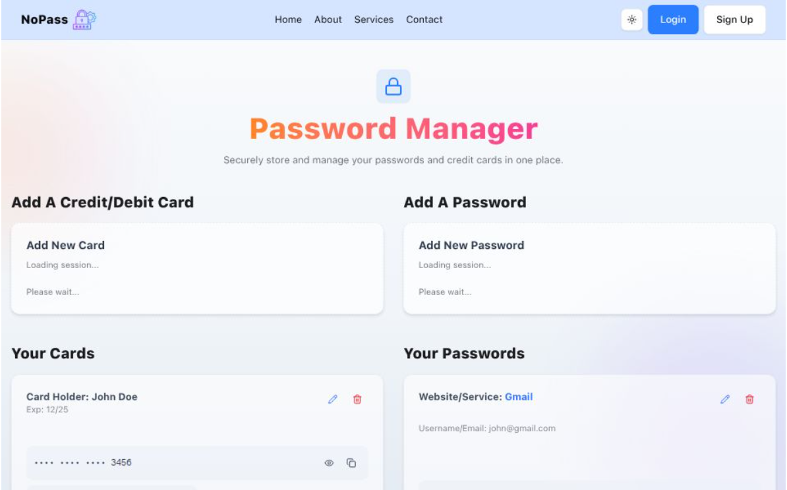
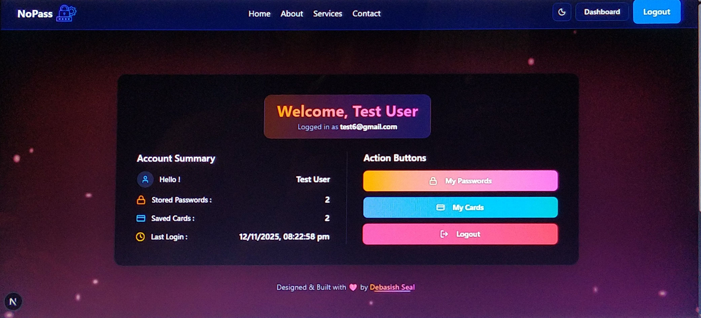
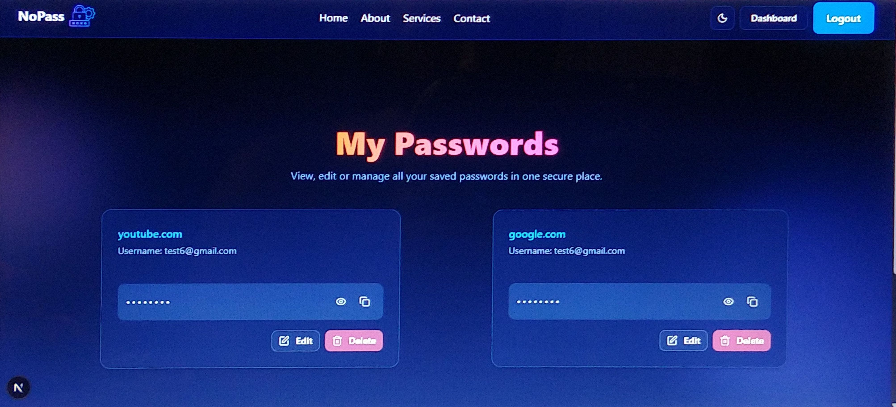
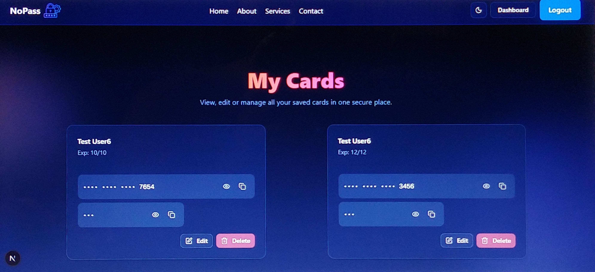
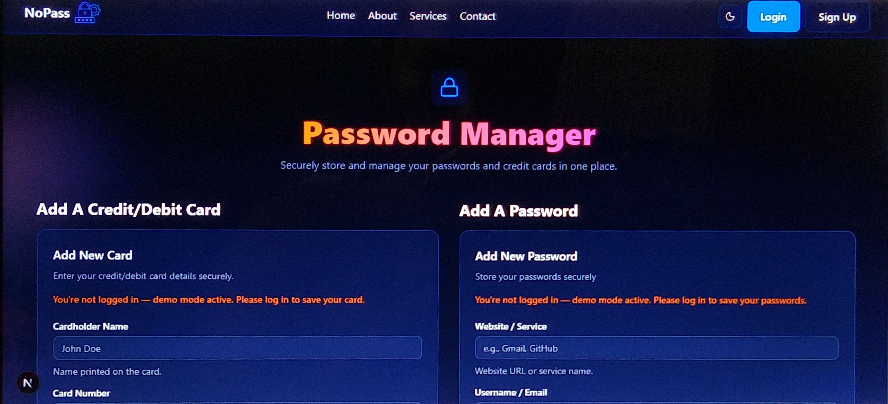

# 🔐 NoPass

> ⚠️ **IMPORTANT NOTICE**  
> This project is **source-available**, NOT open-source.  
> Deployment, redistribution, rebranding, or reuse is strictly prohibited  
> without explicit written permission from the author.

**NoPass** is a secure and modern **Password & Card Manager** built with **Next.js, TypeScript, MongoDB, NextAuth, ShadCN/UI, and TailwindCSS**.  
It allows users to **store, manage, and protect passwords and credit or debit card details** — all in one encrypted, user-friendly dashboard.

---

## 📸 Screenshots

### Home Page  


### Dashboard Page  


### Passwords Page  


### Cards Page  


### Dark Mode Support  


---

## 🔗 Live Demo

👉 [NoPass](https://nopass-deba.vercel.app/)

---

## 🚀 Features

- 🔐 **Authentication System**
  - Email & Password login via NextAuth (Credentials Provider)
  - Secure session handling with JWT
  - Password reset via email with token expiry system  

- 🧠 **Password Management**
  - Securely save, view, and manage password info
  - Add, edit, and delete saved passwords
  - Encrypted storage
  - Auto-prefill edit mode with instant UI updates  

- 💳 **Credit/Debit Card Management**
  - Securely save, view, and manage card info
  - Add, edit, and delete saved cards
  - Encrypted storage
  - Auto-prefill edit mode with instant UI updates  

- 🌗 **Dark / Light Mode Support (Clean UI, accessibility & UX)**
- Dark / Light mode
- Clean, accessible UI (ShadCN/UI)
- Smooth animations (Framer Motion)

- 📩 **Contact Support Page**
  - Auto email response with embedded logo and branding 
  - Authenticated user message validation  
  - Authenticated form submission

- 🗄 **MongoDB Integration (Database)** 
- for persistent data storage  
- MongoDB with optimized schema design

- ⚡ **Deployed on Vercel**

---

## 🛠 Tech Stack

- [Next.js](https://nextjs.org/) – React Framework  
- [TypeScript](https://www.typescriptlang.org/) – Type-Safe Development  
- [MongoDB](https://www.mongodb.com/) – Database  
- [NextAuth](https://next-auth.js.org/) – Authentication  
- [ShadCN/UI](https://ui.shadcn.com/) – Accessible & Reusable UI Components  
- [TailwindCSS](https://tailwindcss.com/) – Styling  
- [Zod](https://zod.dev/) – Schema Validation  
- [React Hook Form](https://react-hook-form.com/) – Form Handling  
- [Nodemailer](https://nodemailer.com/) – Email Sending  
- [Framer Motion](https://www.framer.com/motion/) – Animations  
- [Vercel](https://vercel.com/) – Deployment  

---

## ⚙️ Installation & Setup

> ⚠️ This section is provided **only for learning and contribution purposes**.  
> Deployment or production use is **not allowed**.

1. **Clone the repository**
   ```bash
   git clone https://github.com/perfectCoder-dev/Nopass-App.git
   cd Nopass-App
   ```

2. **Install dependencies**
    ```bash
    npm install
    ```

3. **Setup environment variables**    
    Create a .env.local file and add:
    ```bash
    MONGODB_URI=your_mongodb_connection_string
    NEXT_PUBLIC_BASE_URL=http://localhost:3000
    ENCRYPTION_KEY=your_encryption_key
    NEXTAUTH_URL=http://localhost:3000
    NEXTAUTH_SECRET=your_secret
    GOOGLE_CLIENT_ID=your_google_client_id
    GOOGLE_CLIENT_SECRET=your_google_client_secret
    GITHUB_ID=your_github_client_id
    GITHUB_SECRET=your_github_client_secret
    EMAIL_USER=yourgmail@gmail.com
    EMAIL_PASS=xxxx xxxx xxxx xxxx   # App Password (must be entered without spaces)
    MOBILE_API_URL=http://192.168.x.x:3000
    GITHUB_MOBILE_ID=your_github_mobile_client_id
    GITHUB_MOBILE_SECRET=your_github_mobile_secret
    GOOGLE_MOBILE_CLIENT_ID=your_google_mobile_client_id
    GOOGLE_MOBILE_CLIENT_SECRET=your_google_mobile_client_secret
    ```

    > Make sure to replace `your_mongodb_connection_string` with your actual MongoDB connection URI.

4. **Run the development server**
    ```bash
    npm run dev
    ```

The app will be available at 👉 http://localhost:3000

---

## 📦 Deployment Notes

- This project is deployed on **Vercel** for personal and demonstration purposes.

- Due to encryption keys, authentication providers, and email configurations,
this repository is **not intended for public or private redeployment under any name, domain, or branding**.

## 🔐 Usage Policy

- Viewing and learning: ✅ Allowed

- Contributions (PRs): ⚠️ Allowed (all contributions become property of the author).

- By submitting a pull request, you agree that your contribution
becomes part of the project and is subject to the same license terms.

- Forking: ⚠️ Allowed by GitHub, not permission to reuse

- Deployment / Rebranding / Commercial use: ❌ Not allowed

All forked copies remain bound to the same license terms.

---

## 👨‍💻 Author

**👤 Debasish Seal**

- GitHub: [@2000Deba](https://github.com/2000Deba)
- Portfolio: [Portfolio](https://debasishseal.vercel.app/)
- Live Demo: [NoPass](https://nopass-deba.vercel.app/)

---

## 📜 License

This project is **source-available under a custom license**.
It is **NOT open-source**.

You are allowed to view and contribute to this repository for learning
and contribution purposes only.

❌ Reuse, redistribution, rebranding, modification, or commercial use is **not allowed**
without explicit permission from the author.

Modification is allowed only for local learning or contribution purposes.
Modified versions may NOT be deployed, redistributed, or published.

See the [LICENSE](./LICENSE) file for full legal terms and details.

---

### ⭐ Support

Don't forget to ⭐ star this repo if you like it!

For bugs or feature requests, feel free to open an issue.
